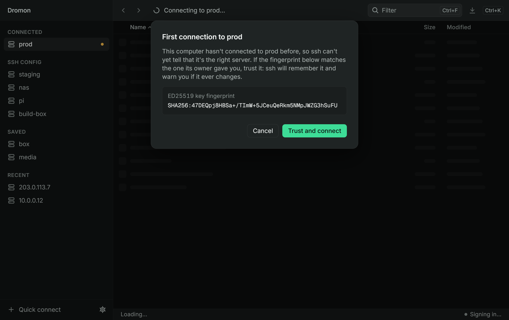
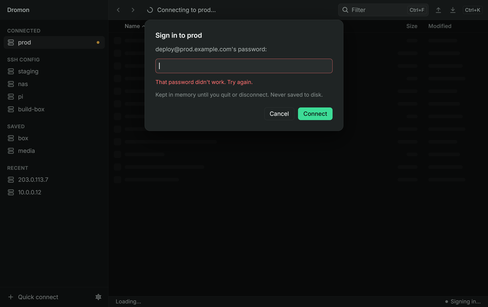
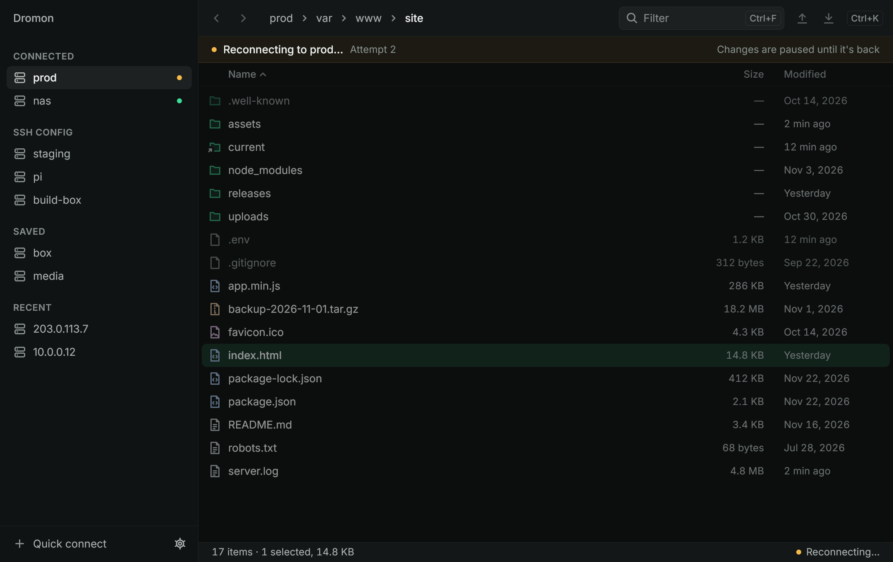
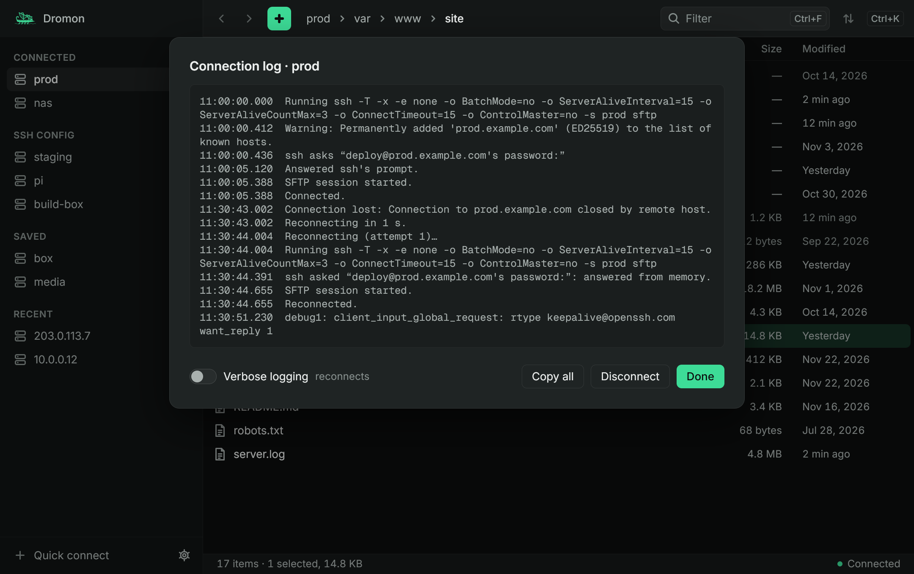

<div align="center">

# ⛵ Dromon

**Browse a remote machine over SSH the way you browse a local folder.**

A small, fast, beautiful SFTP file browser for macOS, Windows and Linux,<br>
written in Rust on the GPU-rendered [Rune](https://github.com/anomalyco/rune) UI framework.

[](https://github.com/fatihdogmus/dromon/actions/workflows/ci.yml)
[](LICENSE)


<picture>
  <source media="(prefers-color-scheme: light)" srcset="tests/goldens/light-light@2x.png">
  
</picture>

</div>

---

> *A dromon was the Byzantine fast war galley; the word comes from the Greek for "runner".*

Dromon is not Cyberduck. It does one thing: **SFTP over the SSH you already have**, in one pane, done extremely well.

## ✨ Why

- **Your SSH setup, as is.** Hosts come straight from `~/.ssh/config` (with `Include`s), and connections run through your system `ssh`: keys, agent, `ProxyJump`, `Match` blocks, all of it.
- **Sign in once.** Passwords, key passphrases and 2FA codes are asked in a native sheet, kept **in memory only**, and reused for silent reconnects. Never written to disk, never logged.
- **Survives your Wi-Fi.** Drop the connection, close the lid: Dromon reconnects in the background with backoff and puts you back where you were.
- **Fast with big folders.** Listings stream in pages and rows are virtualized: a 10,000-entry folder paints its first rows immediately.
- **Crisp.** Inter and Geist Mono, tabular figures, and an icon set drawn twice: once per pixel density, pixel-exact at 1× and 2×.
- **Keyboard first.** Type-to-select, ⌘↑ / ⌘[ / ⌘], ⌘F filter, ⌘⇧. hidden files: [the full list](.plans/dromon-plan.md#7-keyboard-shortcuts).

<table>
  <tr>
    <td width="50%"></td>
    <td width="50%"></td>
  </tr>
  <tr>
    <td align="center"><sub>First connection: check the fingerprint, trust it once.</sub></td>
    <td align="center"><sub>Passwords stay in memory, and only until you quit.</sub></td>
  </tr>
  <tr>
    <td width="50%"></td>
    <td width="50%"></td>
  </tr>
  <tr>
    <td align="center"><sub>Lost the network? It reconnects on its own.</sub></td>
    <td align="center"><sub>A per-host log when you need to know why.</sub></td>
  </tr>
</table>

## 🚧 Status

Early development. What works today: SSH-config hosts, the full sign-in flow (host keys, passwords, passphrases, keyboard-interactive 2FA), browsing, sorting, filtering, silent reconnects. **Next up:** downloads and uploads (drag and drop, conflict handling, resumable transfers), then file operations, quick connect and the ⌘K palette. The roadmap is in [`.plans/dromon-plan.md`](.plans/dromon-plan.md), progress in [`.plans/progress.md`](.plans/progress.md).

## 📦 Install

**Quick install**

```sh
# macOS (Apple silicon) and Linux (Debian/Ubuntu, Arch; x86_64)
curl -fsSL https://raw.githubusercontent.com/fatihdogmus/dromon/main/install.sh | sh
```

```powershell
# Windows
irm https://raw.githubusercontent.com/fatihdogmus/dromon/main/install.ps1 | iex
```

Each one finds the latest release, downloads the right package, checks its SHA-256 against the release's `SHA256SUMS` and installs it silently; set `DROMON_VERSION` (for example `0.1.0`) to pin a version.

On macOS, Homebrew works too, and `brew upgrade` keeps Dromon current:

```sh
brew install --cask fatihdogmus/tap/dromon
```

Or download a file yourself from the [Releases page](https://github.com/fatihdogmus/dromon/releases):

| Platform | File | Notes |
|---|---|---|
| macOS 14+, Apple silicon | `Dromon-<version>-macos-arm64.dmg` | Not notarized yet: **System Settings → Privacy & Security → Open Anyway**, or `xattr -dr com.apple.quarantine /Applications/Dromon.app` |
| Windows 11 (x64; Arm runs it emulated) | `Dromon-<version>-windows-x64.msi` | Not code-signed yet: SmartScreen → **More info → Run anyway** |
| Debian 12+, Ubuntu 22.04+ (x86_64) | `Dromon-<version>-linux-x64.deb` | `sudo apt install ./Dromon-….deb` (pulls in `openssh-client`) |
| Arch Linux (x86_64) | `Dromon-<version>-linux-x64.pkg.tar.zst` | `sudo pacman -U Dromon-….pkg.tar.zst` |

Intel Macs and Arm Linux have no release build yet: [build from source](#build-from-source). Dromon uses your system `ssh` (OpenSSH 8.4 or newer; on Windows, the built-in OpenSSH client).

<details>
<summary><b>Verifying a download</b></summary>

Every file has a build-provenance attestation from GitHub Actions, and the checksums are signed with the release key in [`KEYS`](KEYS):

```sh
gh attestation verify Dromon-<version>-linux-x64.deb --repo fatihdogmus/dromon

gpg --import KEYS          # 61AA 2003 0B81 70BE 3527  E4BA 1E54 8E51 E3AD 8C38
gpg --verify SHA256SUMS.asc SHA256SUMS
sha256sum --check --ignore-missing SHA256SUMS
```

</details>

### Build from source

```sh
git clone https://github.com/fatihdogmus/dromon && cd dromon
cargo run --release -p dromon-app      # the toolchain is pinned in rust-toolchain.toml
```

Linux needs `libxkbcommon-dev` and `libwayland-dev`. Want to look around without a server? `DROMON_MOCK=1 cargo run -p dromon-app` opens a built-in demo.

## 🐛 Reporting a bug

Most bugs can be shown **without your servers**. The [bug report form](https://github.com/fatihdogmus/dromon/issues/new?template=bug.yml) asks for a small *fixture* (fake hosts, folders and sign-in prompts) and a *script* (the clicks and keys), and Dromon replays them headless:

```sh
bash scripts/repro.sh 42      # issue #42 → target/repro/42/{summary.md,end.png,strip.png}
```

Maintainers can comment `/repro` on an issue and CI replies with the same output. Writing the fixture with an AI agent works well: point it at [`docs/fixtures.md`](docs/fixtures.md).

## 🛠️ Development

```sh
cargo test --workspace          # unit, headless UI and end-to-end tests (Docker runs a real sshd)
bash scripts/goldens.sh         # re-render the screenshots above; they're also the visual tests
bash scripts/flows.sh           # render user flows to image strips in target/flows
```

How the code is organised, how to verify a change and how to triage an issue: [`AGENTS.md`](AGENTS.md). How releases are built and signed: [`docs/releasing.md`](docs/releasing.md).

## 🙏 Credits

Built on [Rune](https://github.com/anomalyco/rune) by Anomaly and [russh-sftp](https://github.com/AspectUnk/russh-sftp). Set in [Inter](https://rsms.me/inter/) and [Geist Mono](https://vercel.com/font) (both SIL Open Font License).

## License

[MIT](LICENSE) © Muhammed Fatih Doğmuş
