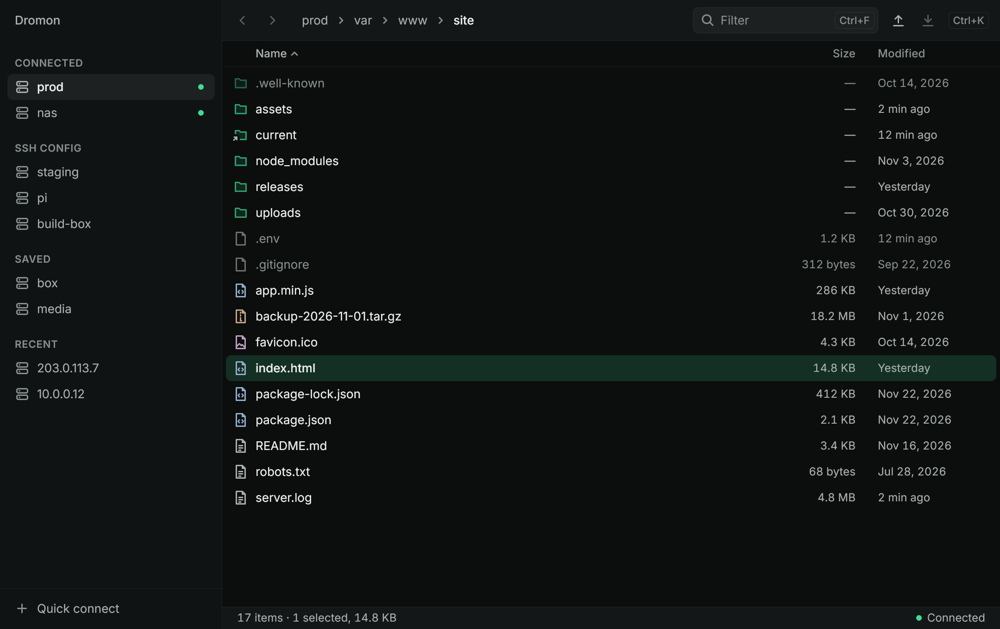
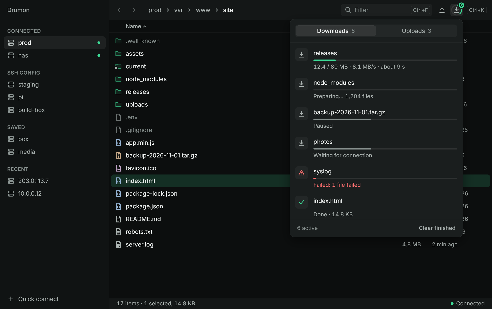
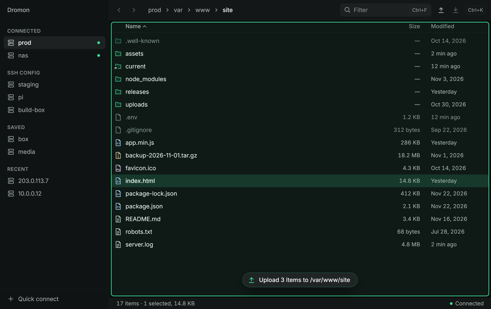
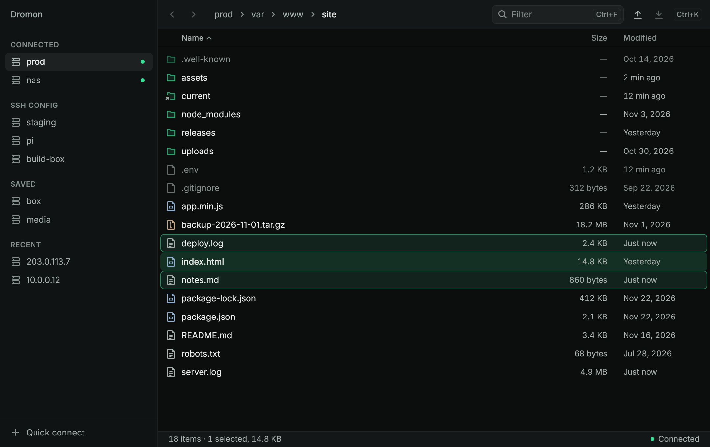
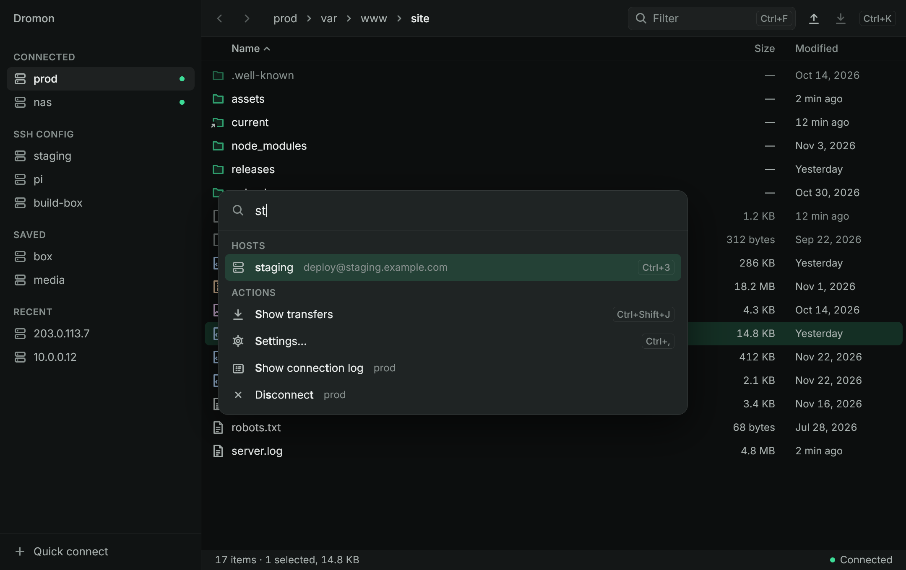
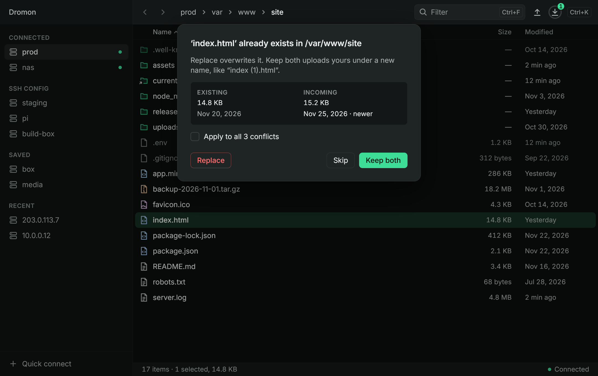

<div align="center">

# ⛵ Dromon

**Browse a remote machine over SSH the way you browse a local folder.**

A small, fast, beautiful SFTP file browser for macOS, Windows and Linux.<br>
Native-feeling, GPU-rendered, and built around the SSH you already use.

[](https://github.com/fatihdogmus/dromon/actions/workflows/ci.yml)
[](LICENSE)


<picture>
  <source media="(prefers-color-scheme: light)" srcset="tests/goldens/light-light@2x.png">
  
</picture>

[**Install**](#install) · [**Features**](#features) · [**Shortcuts**](#shortcuts)

</div>

---

> *A dromon was the Byzantine fast war galley; the word comes from the Greek for "runner".*

Dromon does one thing and does it extremely well: **SFTP over the SSH you already have**, in one clean pane. Open it, pick a host from your SSH config, and you're in. No accounts, no bookmarks to re-create, no second copy of your keys.

<a name="install"></a>

## 📦 Install

**Quick install**

```sh
# macOS (Apple silicon and Intel) and Linux (Debian/Ubuntu, Arch; x86_64)
curl -fsSL https://raw.githubusercontent.com/fatihdogmus/dromon/main/install.sh | sh
```

```powershell
# Windows
irm https://raw.githubusercontent.com/fatihdogmus/dromon/main/install.ps1 | iex
```

Each one finds the latest release, downloads the right package, checks its SHA-256 against the release's `SHA256SUMS` and installs it silently; set `DROMON_VERSION` (for example `0.1.0`) to pin a version.

On macOS, Homebrew works too, and `brew upgrade` keeps Dromon current:

```sh
brew install --cask fatihdogmus/tap/dromon
```

Or download a file yourself from the [Releases page](https://github.com/fatihdogmus/dromon/releases):

| Platform | File | Notes |
|---|---|---|
| macOS 14+, Apple silicon and Intel | `Dromon-<version>-macos-universal.dmg` | Drag Dromon to Applications |
| Windows 11 (x64; Arm runs it emulated) | `Dromon-<version>-windows-x64.msi` | If SmartScreen asks: **More info → Run anyway** |
| Debian 12+, Ubuntu 22.04+ (x86_64) | `Dromon-<version>-linux-x64.deb` | `sudo apt install ./Dromon-….deb` (pulls in `openssh-client`) |
| Arch Linux (x86_64) | `Dromon-<version>-linux-x64.pkg.tar.zst` | `sudo pacman -U Dromon-….pkg.tar.zst` |

Dromon uses your system `ssh` (OpenSSH 8.4 or newer; on Windows, the built-in OpenSSH client). On Arm Linux, [build it from source](#source).

<details>
<summary><b>Verifying a download</b></summary>

Every file has a build-provenance attestation from GitHub Actions, and the checksums are signed with the release key in [`KEYS`](KEYS):

```sh
gh attestation verify Dromon-<version>-linux-x64.deb --repo fatihdogmus/dromon

gpg --import KEYS          # 61AA 2003 0B81 70BE 3527  E4BA 1E54 8E51 E3AD 8C38
gpg --verify SHA256SUMS.asc SHA256SUMS
sha256sum --check --ignore-missing SHA256SUMS
```

</details>

<a name="source"></a>

<details>
<summary><b>Build from source</b></summary>

```sh
git clone https://github.com/fatihdogmus/dromon && cd dromon
cargo run --release -p dromon-app      # the toolchain is pinned in rust-toolchain.toml
```

Linux needs `libxkbcommon-dev` and `libwayland-dev`. Want to look around without a server? `cargo demo` opens a built-in demo.

</details>

## ✨ Why Dromon

- **Your SSH setup, as is.** Hosts come straight from `~/.ssh/config`, `Include`s and all, and every connection runs through your own `ssh`: keys, agent, `ProxyJump`, `Match` blocks. Edit your config and the sidebar updates on its own.
- **Sign in once.** Passwords, key passphrases and 2FA codes are asked in a native sheet, kept **in memory only**, and reused when the connection comes back. Never written to disk, never logged.
- **Transfers that finish.** Drag files in from Finder or Explorer, or press ⌘D to download. Interrupted transfers resume where they stopped, copies on the same server happen server-side in seconds, and a move between servers deletes the original only after the copy checks out.
- **Survives your Wi-Fi.** Close the lid, switch networks: Dromon notices, reconnects in the background and puts you back exactly where you were.
- **Live.** The folder on screen keeps itself up to date. New files fade in, removed ones fold away, and your selection never jumps.
- **Fast with big folders.** Listings stream in and rows are virtualized: a 10,000-file folder shows its first rows in about 15 ms, and 100,000 files scroll smoothly.

<table>
  <tr>
    <td width="50%"></td>
    <td width="50%"></td>
  </tr>
  <tr>
    <td align="center"><sub>Every transfer in one place: progress, speed, time left, resume.</sub></td>
    <td align="center"><sub>Drop files from Finder or Explorer to upload them.</sub></td>
  </tr>
  <tr>
    <td width="50%"></td>
    <td width="50%"></td>
  </tr>
  <tr>
    <td align="center"><sub>What changes on the server shows up by itself.</sub></td>
    <td align="center"><sub>⌘K: hosts, folders and every action, by a few letters.</sub></td>
  </tr>
  <tr>
    <td width="50%"></td>
    <td width="50%"></td>
  </tr>
  <tr>
    <td align="center"><sub>Name clashes show both files before you choose.</sub></td>
    <td align="center"><sub>First connection: check the fingerprint, trust it once.</sub></td>
  </tr>
</table>

<a name="features"></a>

## 🧰 Everything you need, nothing you don't

**Hosts.** Your SSH config, plus quick connect: paste `user@host:port` and go. Save the ones you use, find recent ones in the sidebar, and add any of them to your SSH config in one step, with a backup of the file.

**Signing in.** Host-key checks, passwords, key passphrases, keyboard-interactive 2FA and jump hosts, all in native sheets. Each host has a connection log with a *Verbose logging* switch for the day something goes wrong.

**Files.** Browse, sort, filter, new folder, rename, delete, copy path. Copy, cut and paste work across hosts and windows, and you can drag rows onto a folder, a breadcrumb or another host. Right-click for everything else.

**Transfers.** Downloads and uploads of files and whole folders, with resume, Chrome-style `name (1)` renaming or a Replace / Keep both / Skip choice on clashes. Progress in the toolbar, a badge in the Dock or taskbar, and a notification when a long job finishes while you're elsewhere.

**Made to fit in.** Several windows, light and dark themes, compact or comfortable rows, your own download folder and number of parallel transfers. Respects reduce motion and increased contrast, and every control works with the keyboard and screen readers.

<a name="shortcuts"></a>

## ⌨️ Made for the keyboard

<table>
  <tr><td><kbd>⌘K</kbd></td><td>Command palette: hosts, folders, actions</td><td><kbd>⌘D</kbd> · <kbd>⌘U</kbd></td><td>Download the selection · upload files</td></tr>
  <tr><td><kbd>⌘L</kbd></td><td>Go to a path</td><td><kbd>⌘C</kbd> <kbd>⌘X</kbd> <kbd>⌘V</kbd></td><td>Copy, cut, paste, also between hosts</td></tr>
  <tr><td><kbd>⌘F</kbd></td><td>Filter the folder</td><td><kbd>⌥⌘V</kbd></td><td>Move here</td></tr>
  <tr><td><kbd>⌘↑</kbd> <kbd>⌘[</kbd> <kbd>⌘]</kbd></td><td>Up, back, forward</td><td><kbd>⌘⇧N</kbd> · <kbd>F2</kbd></td><td>New folder · rename</td></tr>
  <tr><td><kbd>⌘1</kbd>…<kbd>⌘9</kbd></td><td>Switch host</td><td><kbd>⌘⌫</kbd></td><td>Delete</td></tr>
  <tr><td><kbd>⌘⇧K</kbd></td><td>Quick connect</td><td><kbd>⌘⇧J</kbd></td><td>Show transfers</td></tr>
  <tr><td><kbd>⌘⇧.</kbd></td><td>Show hidden files</td><td><kbd>⌘N</kbd> · <kbd>⌘,</kbd></td><td>New window · Settings</td></tr>
</table>

On Windows and Linux, <kbd>Ctrl</kbd> takes the place of <kbd>⌘</kbd>; Delete deletes and <kbd>F5</kbd> refreshes. Or just start typing a file's name to jump to it.

## 🐛 Found a bug?

Most bugs can be shown **without your servers**. The [bug report form](https://github.com/fatihdogmus/dromon/issues/new?template=bug.yml) asks for a small *fixture* (fake hosts, folders and sign-in prompts) and a *script* (the clicks and keys), and Dromon replays them headless:

```sh
cargo repro 42      # issue #42 → target/repro/42/{summary.md,end.png,strip.png}
```

Maintainers can comment `/repro` on an issue and CI replies with the same output. Writing the fixture with an AI agent works well: point it at [`docs/fixtures.md`](docs/fixtures.md).

## 🛠️ Contributing

```sh
cargo dev                 # the app with live editing: UI changes appear as you save
cargo demo                # the app on a built-in demo, no servers needed
cargo test --workspace    # unit, headless UI and end-to-end tests (Docker runs a real sshd)
cargo lint                # clippy, as CI runs it
cargo goldens             # re-render the screenshots above; they're also the visual tests
cargo flows               # render user flows to image strips in target/flows
```

`cargo xtask` lists every command.

How the code is organised, how to verify a change and how to triage an issue: [`AGENTS.md`](AGENTS.md). How releases are built and signed: [`docs/releasing.md`](docs/releasing.md).

## 🙏 Credits

Built in Rust on [Rune](https://github.com/anomalyco/rune) by Anomaly and [russh-sftp](https://github.com/AspectUnk/russh-sftp). Set in [Inter](https://rsms.me/inter/) and [Geist Mono](https://vercel.com/font) (both SIL Open Font License).

## License

[MIT](LICENSE) © Muhammed Fatih Doğmuş
